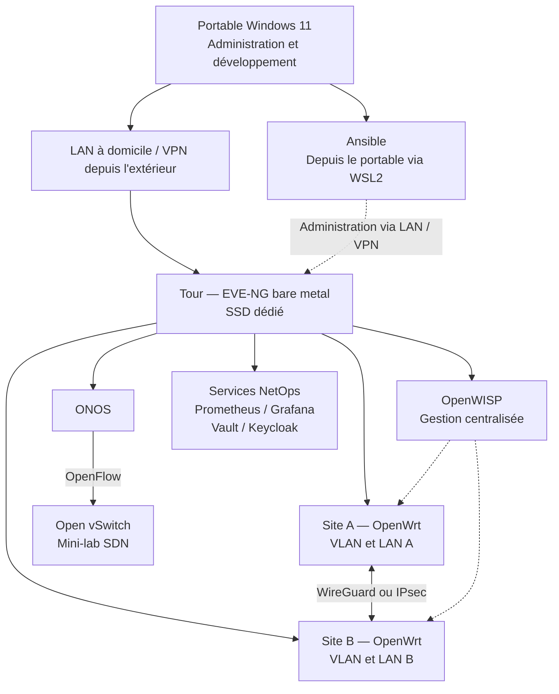

# ARN — Infrastructure réseau NetOps multi-sites

Conception, automatisation, sécurisation et supervision d'une infrastructure réseau virtualisée.

🚧 **Projet en cours de réalisation — phase de conception et de préparation du dépôt.**

## Présentation

Projet individuel réalisé pendant la formation **Administrateur Réseau NetOps (ARN)** : concevoir une infrastructure pour une entreprise fictive comprenant deux sites, plusieurs segments réseau et un petit datacenter virtuel.

La démarche NetOps associe configurations versionnées, automatisation reproductible, supervision et documentation. Le laboratoire doit rester réalisable avec du matériel personnel et démontrable en soutenance, en privilégiant les outils gratuits et ouverts lorsque possible.

## État réel du projet

Les répertoires et la documentation initiale sont versionnés. Le dépôt est relié à GitHub et la publication sur `main` a été vérifiée. La préparation du dépôt est terminée ; la conception du laboratoire se poursuit.

**Aucun service réseau du laboratoire n'est encore déclaré fonctionnel.** Le SSD dédié reste à installer et EVE-NG n'est pas installé. Docker Desktop et WSL2 sont installés sur le portable, mais le dernier test n'accédait pas au daemon Docker et `docker-desktop` était arrêté : aucune stack Docker n'est validée.

Les statuts utilisés sont : **Prévu** (à mettre en place), **En cours** (travail commencé, validation incomplète) et **Fonctionnel** (testé avec preuve documentée). Le dépôt évoluera au fil de la formation.

## Objectifs

- **SD-LAN et segmentation** : VLAN, routage, DHCP et règles entre segments.
- **Gestion centralisée** : équipements OpenWrt et modèles de configuration OpenWISP.
- **WAN sécurisé** : tunnel entre deux sites, chemins WAN simulés et bascule.
- **Automatisation** : inventaires, variables, sauvegardes et playbooks Ansible idempotents.
- **Supervision** : métriques Prometheus, tableaux de bord Grafana et alertes pertinentes.
- **SDN** : séparation du plan de contrôle et du plan de données avec ONOS et Open vSwitch.
- **Sécurité** : accès SSH, rôles, identité centralisée et gestion des secrets.

## Architecture cible

Ce schéma décrit l'architecture **prévue**, pas un déploiement existant. Les liens représentent des relations logiques ; le plan détaillé des flux et des adresses reste à définir.



L'hébergement précis des services auxiliaires sera validé selon les ressources et les besoins de chaque scénario. ONOS pilotera le mini-lab OVS, distinct des équipements OpenWrt principaux.

## Répartition matérielle

| Machine | Ressources | Rôle prévu |
|---|---|---|
| PC tour à domicile | AMD Ryzen 9 5900, 32 Go DDR4, ASUS Prime B450M-A II | Serveur EVE-NG installé directement sur un SSD SATA Samsung 870 EVO dédié |
| PC portable Windows 11 | Intel Core i7-13650HX, 32 Go DDR5 | Développement, Git/GitHub, Ansible via WSL2, SSH, interfaces Web et soutenance |

Les disques Windows existants de la tour doivent être préservés. Le disque de démarrage sera choisi entre Windows et EVE-NG ; le laboratoire sera disponible lorsque la tour démarrera sur EVE-NG. Les GPU ne constituent pas une ressource nécessaire à la virtualisation réseau prévue.

Le portable reste le poste principal et n'hébergera pas le laboratoire EVE-NG final. Depuis l'école, l'administration passera par un VPN vers le réseau domestique. **EVE-NG ne sera jamais directement exposé sur Internet.**

## Stack technique

| Technologie | Rôle | Statut |
|---|---|---|
| EVE-NG | Plateforme de laboratoire réseau sur la tour | Prévu |
| OpenWrt | Routeurs virtuels, VLAN, DHCP, routage et filtrage | Prévu |
| OpenWISP | Gestion centralisée, modèles de configuration et API | Prévu |
| Ansible | Automatisation, sauvegardes et reproductibilité | Prévu |
| Prometheus | Collecte et stockage des métriques | Prévu |
| Grafana | Tableaux de bord et visualisation | Prévu |
| ONOS | Contrôleur du mini-environnement SDN | Prévu |
| Open vSwitch | Plan de données SDN piloté via OpenFlow | Prévu |
| HashiCorp Vault | Stockage et contrôle d'accès aux secrets | Prévu |
| Keycloak | Identités, rôles et authentification des services compatibles | Prévu |
| WireGuard ou IPsec | Tunnel sécurisé entre sites | Prévu — choix à valider |
| mwan3 | Gestion des chemins WAN et tests de bascule | Prévu |
| Git / GitHub | Versionnement et documentation | Fonctionnel — publication initiale vérifiée |
| OPNsense | Démonstration complémentaire de pare-feu | Optionnel — non requis |

Prometheus et Grafana constituent la solution de supervision retenue à ce stade. Les versions, licences, intégrations et ressources nécessaires seront vérifiées avant chaque déploiement ; cette liste n'implique pas une compatibilité déjà validée.

## Organisation du dépôt

```text
ARN/
├── ansible/       # Inventaires, variables sans secrets et playbooks
├── monitoring/    # Configurations Prometheus et dashboards Grafana
├── vault/         # Configuration et documentation de Vault, sans données secrètes
├── keycloak/      # Configuration IAM et exemples assainis
├── openwisp/      # Déploiement et modèles de gestion centralisée
├── docs/          # Procédures, plan d'adressage, tests et dossier de soutenance
├── configs/       # Configurations réseau et exemples sans secrets
├── diagrams/      # Sources des schémas et exports partageables
├── .gitignore
├── LICENSE
└── README.md
```

Les fichiers `.gitkeep` permettent de versionner les répertoires actuellement vides. Les configurations utiles et dépourvues de secrets ont vocation à être conservées dans Git. Aucun fichier de VM ou image d'équipement ne doit être ajouté.

## Sécurité et accès

- **Aucun secret dans Git** : mots de passe, tokens GitHub/API, clés privées et données d'initialisation ou de déverrouillage de Vault restent hors du dépôt.
- Privilégier les clés SSH et limiter les droits aux besoins de chaque rôle.
- Prévoir Vault pour fournir les secrets à l'automatisation au moment nécessaire ; ne pas les inscrire dans les playbooks ou inventaires.
- Exclure `.env` et ses variantes ; un `.env.example` peut être versionné uniquement avec des valeurs fictives.
- Exclure les données locales de Vault, les états Terraform, les fichiers de clés et les images de virtualisation via `.gitignore`.
- Accéder à distance uniquement via VPN ; ne pas publier l'interface EVE-NG sur Internet.
- Documenter les flux d'administration, les rôles et les règles de filtrage ; vérifier les exports avant publication.

Le `.gitignore` est une protection complémentaire : il ne détecte pas un secret placé dans un fichier de configuration autorisé et n'exclut pas automatiquement un fichier déjà suivi. Chaque commit doit donc faire l'objet d'une vérification du contenu ajouté.

## Roadmap

Chaque phase sera validée avec des tests et une documentation avant de déclarer ses services fonctionnels.

- [x] **Phase 0 — Préparation du dépôt** : README, exclusions, structure, commit et publication GitHub vérifiée.
- [ ] **Phase 1 — Installation EVE-NG** : SSD dédié, installation et accès LAN, préservation des disques Windows.
- [ ] **Phase 2 — Premier réseau OpenWrt** : import autorisé des images, interfaces, DHCP et connectivité.
- [ ] **Phase 3 — Segmentation / VLAN** : plan d'adressage, routage et politiques entre segments.
- [ ] **Phase 4 — OpenWISP** : enregistrement des équipements et modèles de configuration.
- [ ] **Phase 5 — Interconnexion multi-sites** : tunnel, chemins WAN simulés, mwan3 et bascule.
- [ ] **Phase 6 — Ansible** : inventaires, playbooks, sauvegardes et preuve d'idempotence.
- [ ] **Phase 7 — Prometheus / Grafana** : collecte, dashboards et alertes utiles.
- [ ] **Phase 8 — ONOS / OVS** : connexion OpenFlow et démonstration du contrôle centralisé.
- [ ] **Phase 9 — Vault / Keycloak** : secrets, rôles et intégrations compatibles.
- [ ] **Phase 10 — Sécurisation et tests** : audit des accès, filtrage et scénarios de panne.
- [ ] **Phase 11 — Documentation / soutenance** : procédures reproductibles, résultats et démonstrations.

La validation de la phase 0 concerne uniquement le dépôt ; les services du laboratoire restent à déployer et à tester.

## Critères de validation

Ces critères sont des objectifs ; aucun résultat n'est encore acquis. Les preuves seront conservées dans `docs/` sous forme de procédures, résultats assainis et captures utiles.

| Domaine | Résultat attendu |
|---|---|
| Connectivité | Communications conformes au plan d'adressage et aux flux autorisés |
| Segmentation | Flux permis accessibles et flux interdits effectivement bloqués |
| Inter-sites | Tunnel opérationnel, routage vérifié et accès limités |
| Résilience WAN | Perte de lien simulée, bascule observée et retour au service documenté |
| Automatisation | Déploiement reproductible ; seconde exécution sans changement non justifié |
| Supervision | Métriques collectées, dashboards lisibles et alerte testée |
| SDN | OVS connecté à ONOS et comportement réseau piloté démontré |
| Secrets / IAM | Aucun secret versionné ; accès aux secrets et aux services contrôlé selon les rôles |
| Documentation | Un scénario peut être reproduit à partir des prérequis et procédures |

## Limites du laboratoire

Le serveur possède **32 Go de RAM** : toutes les machines et tous les services ne seront pas exécutés simultanément. Les démonstrations seront organisées par blocs : OpenWrt/OpenWISP, WAN, Ansible, supervision, ONOS/OVS, puis Vault/Keycloak. Les allocations et la consommation réelle seront mesurées avant d'étendre le lab.

OpenWISP illustre une gestion centralisée open source et une approche de cloud privé ; il ne sera pas présenté comme un équivalent exact des offres SaaS constructeur Mist ou Meraki. Le WAN simulé démontre des mécanismes utilisés en SD-WAN, sans constituer une solution constructeur complète.

Il s'agit d'un **environnement pédagogique, pas d'une architecture de production**. La disponibilité dépend du serveur unique et de son démarrage sur EVE-NG. Performances, redondance, montée en charge et exploitation continue ne sont pas garanties. La soutenance distinguera ce qui est testé, ce qui reste prévu et ce qui nécessiterait une conception différente en production.

## Compétences et thèmes étudiés

Réseau local, VLAN et routage ; virtualisation réseau ; WAN sécurisé ; gestion centralisée ; automatisation et Ansible ; supervision ; SDN ; sécurité des accès ; IAM ; gestion des secrets ; documentation et reproductibilité.

Le projet ne revendique pas une couverture intégrale du référentiel ARN. Pour chaque thème, le dossier de formation explicitera le choix technique, le fonctionnement, les preuves de validation et les limites du laboratoire.
