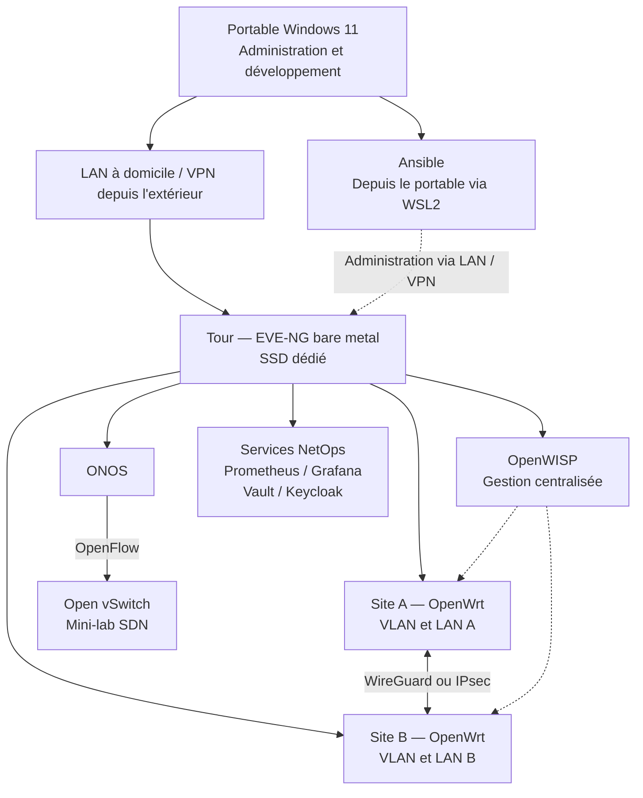

# ARN — Infrastructure réseau NetOps multi-sites

Conception, automatisation, sécurisation et supervision d'une infrastructure réseau virtualisée.

## Présentation

Projet individuel réalisé pendant la formation **Administrateur Réseau NetOps (ARN)** : concevoir une infrastructure pour une entreprise fictive comprenant deux sites, plusieurs segments réseau et un petit datacenter virtuel.

La démarche NetOps associe configurations versionnées, automatisation reproductible, supervision et documentation. Le laboratoire doit rester réalisable avec du matériel personnel et démontrable en soutenance, en privilégiant les outils gratuits et ouverts lorsque possible.

## Objectifs

- **SD-LAN et segmentation** : VLAN, routage, DHCP et règles entre segments.
- **Gestion centralisée** : équipements OpenWrt et modèles de configuration OpenWISP.
- **WAN sécurisé** : tunnel entre deux sites, chemins WAN simulés et bascule.
- **Automatisation** : inventaires, variables, sauvegardes et playbooks Ansible idempotents.
- **Supervision** : métriques Prometheus, tableaux de bord Grafana et alertes pertinentes.
- **SDN** : séparation du plan de contrôle et du plan de données avec ONOS et Open vSwitch.
- **Sécurité** : accès SSH, rôles, identité centralisée et gestion des secrets.

## Architecture cible

Ce schéma présente l'architecture cible du laboratoire. Les liens représentent des relations logiques ; les plans détaillés d'adressage et de flux relèvent de la documentation technique dans `docs/`.



L'hébergement des services auxiliaires dépend des ressources et des besoins de chaque scénario. Ansible s'exécute depuis le portable via WSL2 pour administrer le laboratoire. ONOS assure le contrôle du mini-lab OVS, distinct des équipements OpenWrt principaux.

## Répartition matérielle

| Machine | Ressources | Rôle |
|---|---|---|
| PC tour à domicile | AMD Ryzen 9 5900, 32 Go DDR4, ASUS Prime B450M-A II | Serveur EVE-NG installé directement sur un SSD SATA Samsung 870 EVO dédié |
| PC portable Windows 11 | Intel Core i7-13650HX, 32 Go DDR5 | Développement, Git/GitHub, Ansible via WSL2, SSH, interfaces Web et soutenance |

Les disques Windows existants de la tour doivent être préservés. Le choix du disque de démarrage permet d'utiliser Windows ou EVE-NG ; l'accès au laboratoire nécessite le démarrage de la tour sur EVE-NG. Les GPU ne constituent pas une ressource nécessaire à la virtualisation réseau.

Le portable constitue le poste d'administration et de développement ; le laboratoire EVE-NG est destiné à la tour. Depuis l'école, les accès d'administration passent par un VPN vers le réseau domestique. **EVE-NG ne doit jamais être directement exposé sur Internet.**

## Stack technique

| Technologie | Rôle |
|---|---|
| EVE-NG | Plateforme de laboratoire réseau en bare metal sur la tour |
| OpenWrt | Routeurs virtuels, VLAN, DHCP, routage et filtrage |
| OpenWISP | Gestion centralisée, modèles de configuration et API |
| Ansible | Automatisation, sauvegardes et reproductibilité |
| Prometheus | Collecte et stockage des métriques |
| Grafana | Tableaux de bord et visualisation |
| ONOS | Contrôleur du mini-environnement SDN |
| Open vSwitch | Plan de données SDN piloté via OpenFlow |
| HashiCorp Vault | Gestion et contrôle d'accès aux secrets |
| Keycloak | Identités, rôles et authentification des services compatibles |
| WireGuard / IPsec | Tunnel sécurisé inter-sites |
| mwan3 | Gestion de plusieurs chemins WAN et bascule |
| Git / GitHub | Versionnement, documentation et traçabilité |
| OPNsense | Extension facultative pour la sécurité locale, sans dépendance pour le reste du laboratoire |

Prometheus et Grafana constituent la solution de supervision retenue. Chaque déploiement nécessite la vérification des versions, licences, intégrations et ressources ; la présence d'une technologie dans cette architecture cible ne constitue pas une preuve de validation.

## Organisation du dépôt

```text
ARN/
├── ansible/       # Inventaires, variables sans secrets et playbooks
├── monitoring/    # Configurations Prometheus et dashboards Grafana
├── vault/         # Configuration et documentation de Vault, sans données secrètes
├── keycloak/      # Configuration IAM et exemples assainis
├── openwisp/      # Déploiement et modèles de gestion centralisée
├── docs/          # Procédures, plan d'adressage, tests et dossier de soutenance
├── configs/       # Configurations réseau et exemples sans secrets
├── diagrams/      # Sources des schémas et exports partageables
├── .gitignore
├── LICENSE
└── README.md
```

Les fichiers `.gitkeep` permettent de versionner les répertoires vides. Les configurations utiles et dépourvues de secrets ont vocation à être conservées dans Git. Aucun fichier de VM ou image d'équipement ne doit être ajouté.

## Sécurité et accès

- **Aucun secret dans Git** : mots de passe, tokens GitHub/API, clés privées et données d'initialisation ou de déverrouillage de Vault restent hors du dépôt.
- Privilégier les clés SSH et limiter les droits aux besoins de chaque rôle.
- Utiliser Vault pour fournir les secrets à l'automatisation au moment nécessaire ; ne pas les inscrire dans les playbooks ou inventaires.
- Exclure `.env` et ses variantes ; un `.env.example` peut être versionné uniquement avec des valeurs fictives.
- Exclure les données locales de Vault, les états Terraform, les fichiers de clés et les images de virtualisation via `.gitignore`.
- Accéder à distance uniquement via VPN ; ne pas publier l'interface EVE-NG sur Internet.
- Documenter les flux d'administration, les rôles et les règles de filtrage ; vérifier les exports avant publication.

Le `.gitignore` est une protection complémentaire : il ne détecte pas un secret placé dans un fichier de configuration autorisé et n'exclut pas automatiquement un fichier déjà suivi. Chaque commit doit donc faire l'objet d'une vérification du contenu ajouté.

## Critères de validation

Ces critères définissent les résultats attendus pour les démonstrations. Leur validation exige des preuves documentées dans `docs/` : procédures, résultats assainis et captures utiles.

| Domaine | Résultat attendu |
|---|---|
| Connectivité | Communications conformes au plan d'adressage et aux flux autorisés |
| Segmentation | Flux permis accessibles et flux interdits effectivement bloqués |
| Inter-sites | Tunnel opérationnel, routage vérifié et accès limités |
| Résilience WAN | Perte de lien simulée, bascule observée et retour au service documenté |
| Automatisation | Déploiement reproductible ; seconde exécution sans changement non justifié |
| Supervision | Métriques collectées, dashboards lisibles et alerte testée |
| SDN | OVS connecté à ONOS et comportement réseau piloté démontré |
| Secrets / IAM | Aucun secret versionné ; accès aux secrets et aux services contrôlé selon les rôles |
| Documentation | Un scénario peut être reproduit à partir des prérequis et procédures |

## Limites du laboratoire

Le serveur possède **32 Go de RAM** : les composants peuvent être exécutés séparément pour maîtriser la consommation mémoire. Les démonstrations s'organisent par blocs : OpenWrt/OpenWISP, WAN, Ansible, supervision, ONOS/OVS et Vault/Keycloak. Le dimensionnement repose sur les allocations et la consommation mesurée pour chaque scénario.

OpenWISP illustre une gestion centralisée open source et une approche de cloud privé ; il ne constitue pas un équivalent exact des offres SaaS constructeur Mist ou Meraki. Le WAN simulé démontre des mécanismes utilisés en SD-WAN, sans constituer une solution constructeur complète.

Il s'agit d'un **environnement pédagogique, pas d'une architecture de production**. La disponibilité dépend du serveur unique et de son démarrage sur EVE-NG. Performances, redondance, montée en charge et exploitation continue ne sont pas garanties. La soutenance s'appuie sur des preuves de test et explicite les adaptations nécessaires à une exploitation en production.

## Compétences et thèmes étudiés

Réseau local, VLAN et routage ; virtualisation réseau ; WAN sécurisé ; gestion centralisée ; automatisation et Ansible ; supervision ; SDN ; sécurité des accès ; IAM ; gestion des secrets ; documentation et reproductibilité.

Le projet ne revendique pas une couverture intégrale du référentiel ARN. Pour chaque thème, le dossier de formation explicite le choix technique, le fonctionnement, les preuves de validation et les limites du laboratoire.
