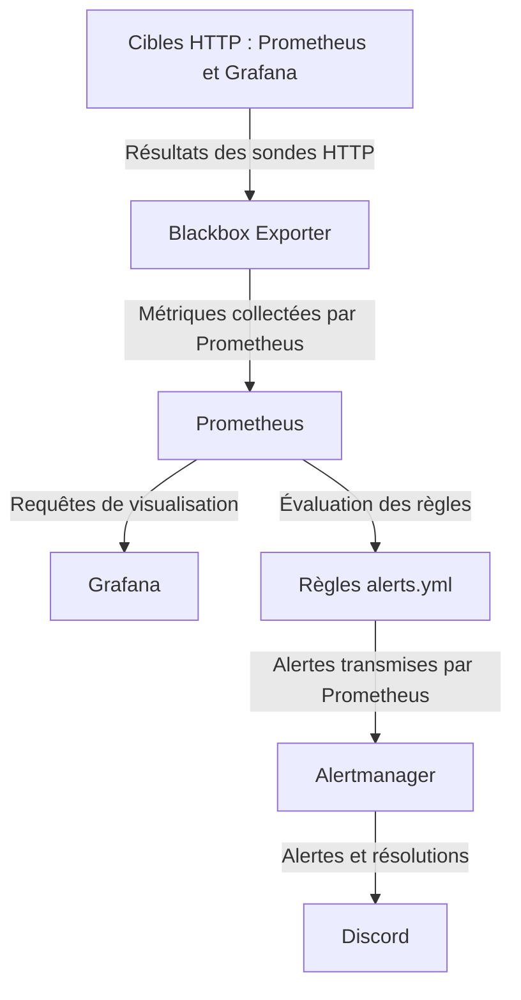

# ARN — Supervision et alertes

Stack Docker Compose de supervision HTTP : Prometheus collecte les métriques de Blackbox Exporter, Grafana les visualise et Alertmanager transmet les alertes et leurs résolutions à Discord.

Cette stack tourne sur le portable comme prototype reproductible. Elle peut être transférée vers une VM de management du laboratoire EVE-NG en conservant ses configurations, son provisioning et ses données persistantes.

## Architecture



Les flèches illustrent le chemin de l'information. Blackbox effectue les requêtes HTTP vers les cibles ; Prometheus interroge Blackbox et Grafana interroge Prometheus. Les règles sont évaluées dans Prometheus, sans service supplémentaire.

## Services et interfaces locales

| Service | Interface | Rôle et configuration |
|---|---|---|
| Prometheus | <http://localhost:9090> | Collecte et stockage des métriques ; configuration `prometheus.yml`, règles `alerts.yml`, données dans `arn_prometheus_data` |
| Grafana | <http://localhost:3000> | Visualisation ; datasource Prometheus provisionnée automatiquement et dashboard **ARN - Supervision** chargé depuis JSON ; données dans `arn_grafana_data` |
| Blackbox Exporter | <http://localhost:9115> | Sondes HTTP définies dans `blackbox.yml`, module `http_2xx` |
| Alertmanager | <http://localhost:9093> | Réception des alertes Prometheus et notifications Discord ; configuration `alertmanager.yml`, stockage dans `arn_alertmanager_data` |

Prometheus collecte les métriques et évalue les règles toutes les **15 secondes**. Le job `prometheus` collecte ses propres métriques ; le job `blackbox-http` utilise `/probe` sur `blackbox-exporter:9115` pour tester les endpoints internes :

- Prometheus : `http://prometheus:9090/-/ready` ;
- Grafana : `http://grafana:3000/api/health`.

Le module `http_2xx` utilise une requête GET, un délai maximal de 5 secondes et privilégie IPv4. **`probe_success = 1` signifie succès ; `probe_success = 0` signifie échec.** La métrique `up` indique la réussite de la collecte Prometheus ; elle ne remplace pas le résultat de la sonde HTTP.

## Provisioning Grafana

- `grafana/provisioning/datasources/prometheus.yml` définit la datasource par défaut `Prometheus`, UID `prometheus`, vers `http://prometheus:9090`.
- `grafana/provisioning/dashboards/dashboards.yml` charge les dashboards dans le dossier Grafana `ARN` depuis `/etc/grafana/dashboards`.
- `grafana/dashboards/arn-supervision.json` définit **ARN - Supervision** : cibles UP/DOWN, sondes OK/KO, disponibilité HTTP, codes HTTP et temps de réponse. Le rafraîchissement est de 10 secondes.

Le provisioning et les fichiers JSON sont montés en lecture seule. Les modifications effectuées dans l'interface ne réécrivent pas le JSON source ; celui-ci sert de référence pour reproduire le dashboard.

## Alerte ServiceHTTPDown

La règle figure dans `alerts.yml`, groupe `arn-service-alerts` :

```yaml
alert: ServiceHTTPDown
expr: probe_success{job="blackbox-http"} == 0
for: 1m
labels:
  severity: critical
  project: ARN
```

Une sonde en échec déclenche l'état **Pending**. Si la condition reste vraie pendant une minute, l'alerte passe à **Firing** et Prometheus la transmet à Alertmanager sur `alertmanager:9093`. Le retour de la sonde à 1 résout l'alerte.

Alertmanager utilise le récepteur `arn-discord`, regroupe par `alertname` et `instance`, attend 10 secondes avant le premier envoi, espace les mises à jour d'un groupe de 30 secondes et répète une alerte persistante toutes les heures. `send_resolved: true` active les notifications de résolution. Les délais de collecte, d'évaluation et de regroupement s'ajoutent au délai de la règle : la notification n'est pas nécessairement reçue exactement une minute après l'arrêt du service.

## Scénario de validation

Le test de bout en bout validé repose sur une interruption volontaire de Grafana :

1. Arrêt de Grafana.
2. Blackbox retourne `probe_success = 0` pour sa cible HTTP.
3. L'alerte passe à **Pending** dans Prometheus.
4. Après une minute de condition vraie, elle passe à **Firing**.
5. Alertmanager reçoit l'alerte.
6. Une notification Discord est reçue.
7. Redémarrage de Grafana.
8. `probe_success` revient à `1`.
9. L'alerte est résolue (**Resolved**).
10. Une notification de résolution Discord est reçue.

## Commandes essentielles

Exécuter ces commandes depuis le dossier `monitoring/`, avec Docker démarré. Les volumes externes et le fichier secret local doivent être disponibles avant le lancement.

```powershell
docker compose up -d
docker compose ps
docker compose down
```

Vérification des configurations, avec les conteneurs concernés démarrés :

```powershell
docker exec prometheus promtool check config /etc/prometheus/prometheus.yml
docker exec prometheus promtool check rules /etc/prometheus/alerts.yml
docker exec alertmanager amtool check-config /etc/alertmanager/alertmanager.yml
```

## Persistance et reproduction

| Volume Docker externe | Contenu | Montage dans le conteneur |
|---|---|---|
| `arn_grafana_data` | Données Grafana | `/var/lib/grafana` |
| `arn_prometheus_data` | Séries temporelles Prometheus | `/prometheus` |
| `arn_alertmanager_data` | État Alertmanager, notamment silences et suivi des notifications | `/alertmanager` |

Les volumes sont déclarés avec `external: true` : Compose ne les crée pas. Sur un nouvel hôte, créer les volumes avant le démarrage, puis restaurer les données si nécessaire :

```powershell
docker volume create arn_grafana_data
docker volume create arn_prometheus_data
docker volume create arn_alertmanager_data
```

`docker compose down` arrête et supprime les conteneurs et le réseau Compose, sans supprimer ces données. **Ne pas ajouter `-v` lorsque l'objectif est de conserver les données.** Les volumes externes sont exclus de la suppression par Compose ; leur suppression manuelle reste destructive. Un transfert vers la VM de management implique aussi la sauvegarde et la restauration des volumes si l'historique doit être conservé.

## Sécurité

- Tous les ports publiés sont liés uniquement à **`127.0.0.1`** : les interfaces ne sont pas exposées directement sur le LAN ou Internet.
- Aucun secret ne doit être stocké dans Git. Le dossier `secrets/` est ignoré.
- L'URL du webhook Discord est conservée uniquement dans `secrets/discord-webhook-url.txt`, monté en lecture seule vers `/run/secrets/discord_webhook_url` dans Alertmanager.
- `alertmanager.yml` référence ce fichier via `webhook_url_file` ; la valeur du webhook ne doit jamais apparaître dans les fichiers versionnés, la documentation ou les sorties partagées.
- Lors d'un transfert, fournir le secret séparément par un canal sécurisé et conserver la restriction des interfaces à la boucle locale.
